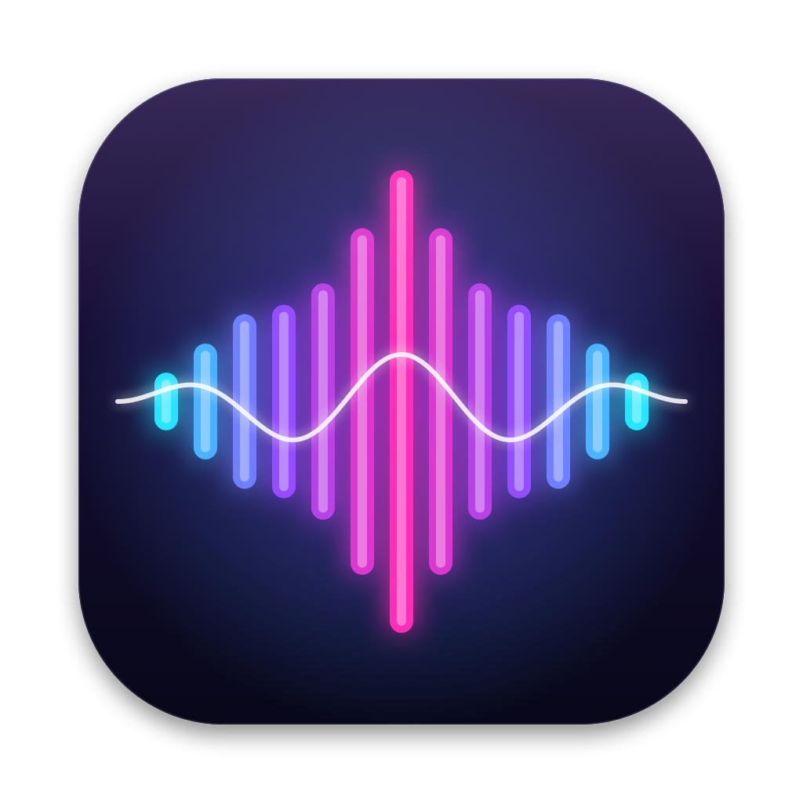
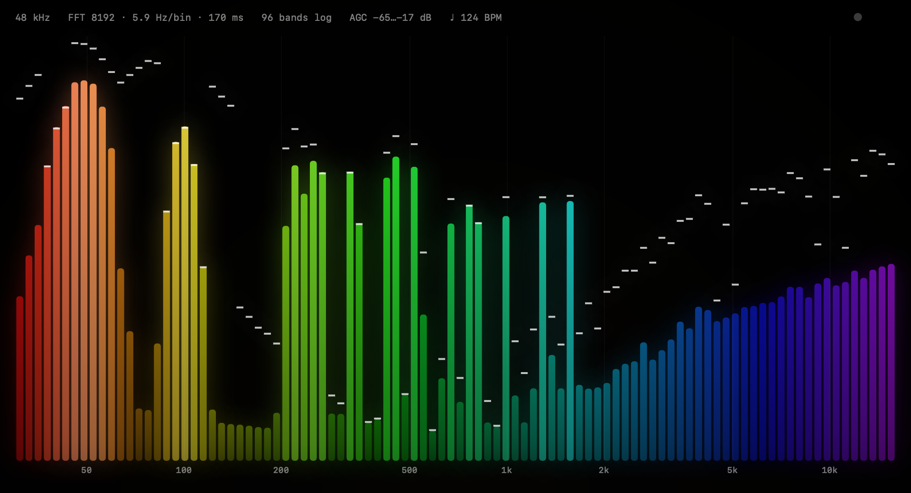
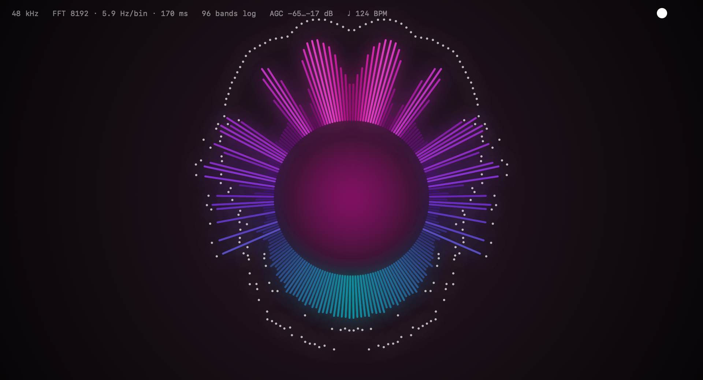
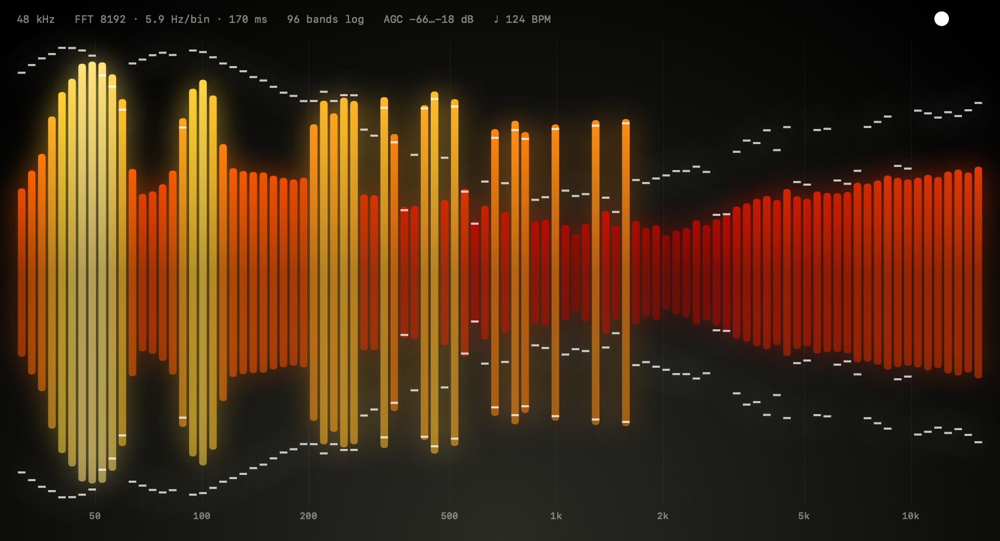
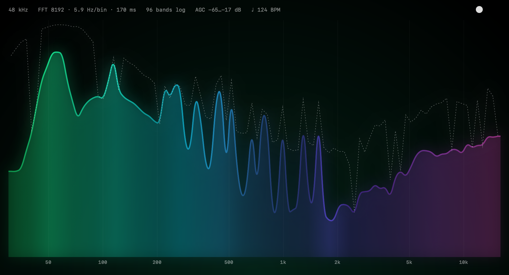
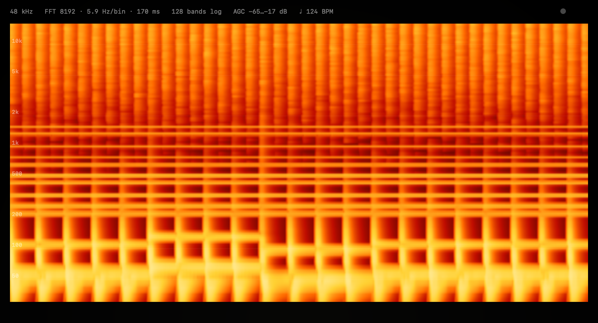
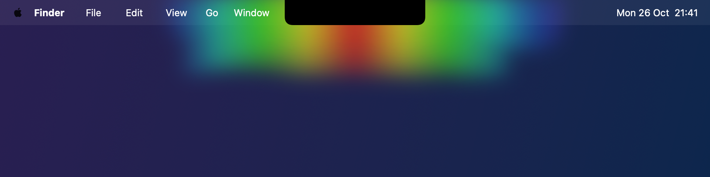
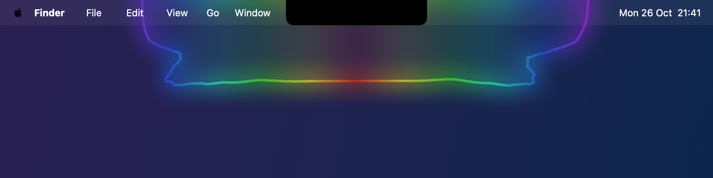
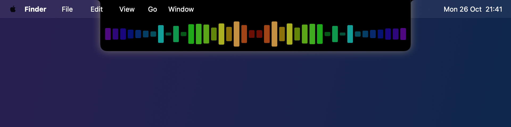
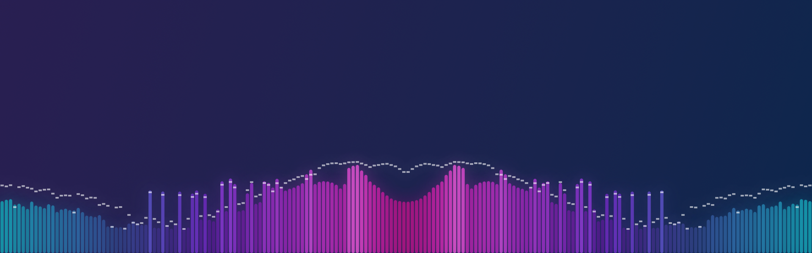

# AudioViz

A native macOS audio visualizer for whatever your Mac is playing — in a window, as a click-through screen overlay (edges, menu bar, notch), or as a live desktop wallpaper.

<p align="center"></p>



| Radial | Mirror |
|---|---|
|  |  |
| **Line** | **Spectrogram** |
|  |  |

### Notch & screen overlays






<sub>Images are rendered offline with the app's own renderer from a synthetic 124 BPM track (`docs/render-screenshots.swift`).</sub>

## Features

- **System audio capture** via Core Audio process taps (macOS 14.2+) — no virtual audio driver needed
- **Lots of knobs**: frequency range, band count, log/mel/bark/linear scales, FFT size & window, tilt, 3-band EQ, A-weighting, response curve
- **Adaptive**: auto gain, per-band whitening, adaptive noise floor, noise gate, beat detection with BPM on a band you choose
- **Modes**: bars, mirror, radial, line, spectrogram, waveform scope · 6 palettes · glow & peaks
- **Screen overlay**: bottom/top/sides/frame/notch, per-display placement, span across monitors, optionally behind the menu bar
- **Notch styles**: Aura, Halo, Island, Breathe, Underline, Dots, Wings
- **Desktop visualizer**: live wallpaper that only shows on displays with no windows (overlays step aside while it's visible)
- Presets, right-click to reset any control, settings persist

## Build

```sh
./build.sh          # build build/AudioViz.app
./build.sh run      # build and launch
./build.sh install  # build, copy to /Applications and launch
```

On first launch, allow AudioViz under **System Settings › Privacy & Security › Screen & System Audio Recording**.

Shortcuts: ⌘1–6 modes · ⌘K controls · ⌘P palette · ⌘O overlay · ⇧⌘D desktop · ⌘R restart capture
